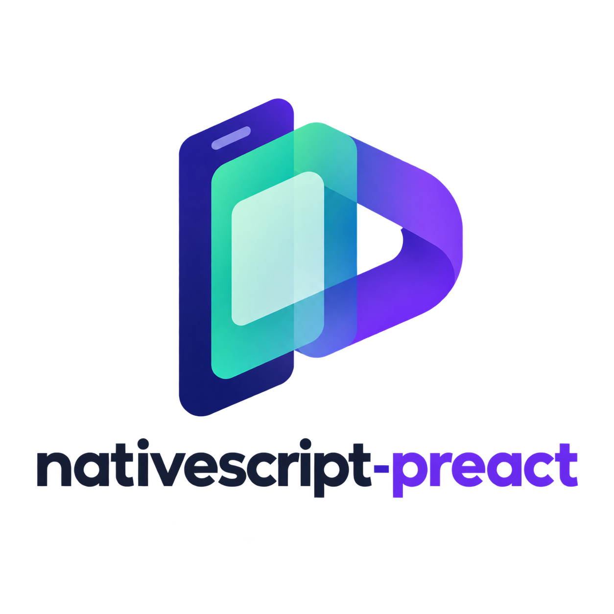

  

<h1 align="center">NativeScript Preact</h1>

  A home for Preact on native iOS and Android.

  <strong>Status: Planning</strong> · <a href="./LICENSE">MIT License</a>

## About

NativeScript Preact is an independent community project exploring a Preact integration for NativeScript. The goal is to build truly native iOS and Android apps with JSX, hooks, and native UI components, without WebViews.

## Project status

This repository currently contains documentation, branding, and repository configuration only. Implementation has not started, and this project has no package or release available to install yet.

The API, architecture, and tooling are still to be explored. The items below describe the intended direction, not available features.

## Intended direction

- Use Preact components, JSX, hooks, and context to describe native interfaces.
- Render NativeScript UI components on iOS and Android.
- Provide TypeScript support and typed native elements.
- Explore native navigation, lifecycle handling, and a smooth development workflow.

## Get involved

Ideas, use cases, and documentation improvements are welcome. Start with the [contribution guide](./CONTRIBUTING.md) or [open an issue](https://github.com/rafaelaugustos/nativescript-preact/issues) to join the discussion.

## License

[MIT](./LICENSE) © 2026 Rafael Augusto.
